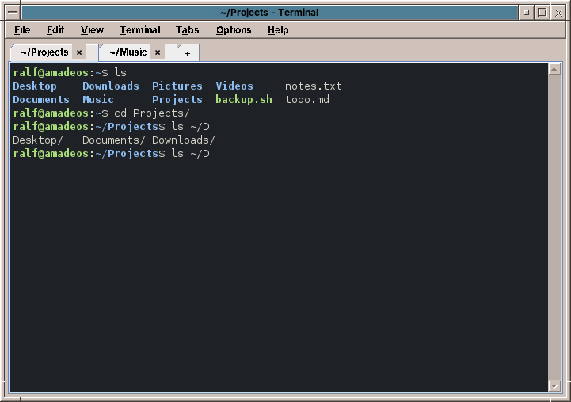
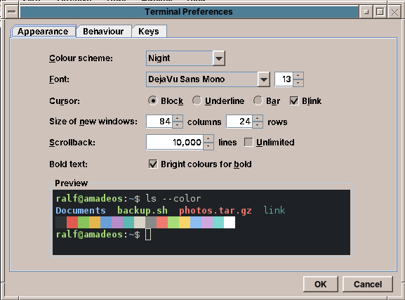

# amade-terminal

**amade-terminal** is the terminal of the [amadeOS](https://github.com/amadeos-eu/amadeos) desktop. It runs the shell and command line programs in tabs, with its own xterm compatible emulator on a real pseudo terminal. Built like the other amadeOS applications.




## Features

- **Your shell** (from `/etc/passwd`, normally bash) on its own pseudo terminal, so everything works as in any other terminal: **Tab completion** (with the `bash-completion` package also for options of apt, git, systemctl, ...), history with the arrow keys and Ctrl+R, job control with Ctrl+Z and Ctrl+C.
- **Full screen programs**: top, htop, vim, nano, less, mc, tmux. `TERM=xterm-256color`; 16, 256 and true colours, bold, italic, underline, strike through, the alternate screen, mouse reporting, bracketed paste, cursor shapes, window titles, line drawing and wide characters (CJK, emoji).
- **Copy and paste**: selecting text copies it to the selection, the middle mouse button pastes it (xterm style). Ctrl+Shift+C and Ctrl+Shift+V (or Shift+Insert) use the clipboard. Double click selects a word or path, triple click the line. Files dropped on the window are pasted as quoted paths.
- **Paste warning**: before several lines are pasted into a program that would run them at once, a dialog shows them and offers *Paste as One Line*.
- **Tabs** (Ctrl+Shift+T) and windows (Ctrl+Shift+N); a new tab opens in the folder of the current one. Tabs can be dragged, closed with the middle mouse button, and show a mark after a bell. Closing a tab or window with a running program asks first.
- **Scrollback** of 10,000 lines (up to unlimited), with Shift+Page Up and the mouse wheel; the text is rewrapped when the window gets narrower or wider.
- **Find** (Ctrl+Shift+F) in the scrollback, with match case and regular expressions.
- **Links**: web addresses and file paths are underlined under the mouse and open with Ctrl+click (OSC 8 hyperlinks too).
- **Preferences** (Ctrl+Shift+comma) with a live preview: colour schemes Night, Paper, Desktop theme (follows the amadeOS theme), Green and Amber screen; font and size (Ctrl+plus/minus/0 to zoom), cursor shape and blinking, bright bold text, scrollback, a custom command or login shell, bell as sound, flash or notification.

  
- **Full screen** (F11), *Terminal → Open Folder in Files*, *Reset* and *Clear Scrollback*.
- `x-terminal-emulator`: the package registers amade-terminal, so programs and desktop entries with `Terminal=true` open in it.
- Five languages (English, Deutsch, Français, Español, Italiano), following the amadeOS desktop language; *Options → Language* overrides it.
- Theme colours and Motif look from [amade-commons](https://github.com/amadeos-eu/amade-commons).

### Keys

| Key | Action |
|---|---|
| Ctrl+Shift+C, Ctrl+Shift+V | Copy, paste |
| Shift+Insert, middle mouse button | Paste the selection |
| Ctrl+Shift+T, Ctrl+Shift+N | New tab, new window |
| Ctrl+Shift+W, Ctrl+Shift+Q | Close tab, close window |
| Ctrl+Page Up/Down, Alt+1..9 | Previous/next tab, tab 1 to 9 |
| Ctrl+Shift+Page Up/Down | Move the tab |
| Shift+Page Up/Down, Shift+Home/End | Scroll the scrollback |
| Ctrl+Shift+F, Ctrl+Shift+A, Ctrl+Shift+K | Find, select all, clear scrollback |
| Ctrl+plus, Ctrl+minus, Ctrl+0 | Zoom |
| F11 | Full screen |
| Ctrl+Shift+comma | Preferences |

All other keys go to the program, including Ctrl+C, Ctrl+D, Ctrl+Z, Ctrl+W and F1 to F12. Hold Shift to select text in programs that use the mouse.

### Command line

```sh
amade-terminal                          # the shell in your home folder
amade-terminal -w ~/Projects            # in a folder
amade-terminal -T "Root Shell" -e sudo -i
amade-terminal --hold -e make           # keeps the tab open after the program ended
```

`-e`/`-x`/`--` (the rest is the command), `-T`/`--title`, `-w`/`--working-directory`, `--hold` and `--version`, the options of xterm and other terminals that programs use with `x-terminal-emulator`.

## Platforms

Linux only (deb). The pseudo terminal comes from the C library through Java's Foreign Function and Memory API (`posix_openpt`), the session from `setsid` (util-linux).

## Architecture

Java 25, Swing and Guice; start-up, theme and language come from `AmadeApplication` in amade-commons. No native libraries and no terminal library: the emulator is plain Java and is tested without a window.

| Package | Contents |
|---|---|
| `bootstrap` | `AmadeTerminalApplication` (command line), `TerminalModule` |
| `emulator` | `Parser` (the DEC/ANSI state machine), `TerminalEmulator` (screens, scrollback, modes, SGR, OSC), `Line`, `Attr`, `Scrollback`, `CharWidth`, `Utf8Decoder`, `KeyEncoder`, `MouseEncoder`, `TextModel` (selection text, words, links, find) |
| `pty` | `Libc` (FFM handles), `UnixPty` (open, read, write, resize), `PtySession` (starts the program, reads its output, hangs up) |
| `domain` | `TerminalSettings`, `ColorScheme`, `Palette`, `CursorShape`, `LaunchOptions`, `ShellCommand`, `TabTitles`, `PasteText` |
| `repository` | `TerminalPreferences` (`~/.config/amadeos/terminal/terminal.properties`) |
| `ui` | `TerminalApp`, `MainWindow` (menus, tabs), `TerminalTab`, `TerminalView` (painting, keys, mouse, selection), `BoxDrawing`, `FindBar`, `PasteWarning`, `PreferencesDialog` |

A reader thread per tab reads the program's output and feeds it into the emulator; the view paints the changed screen at most 60 times a second. Keys and mouse go through `KeyEncoder` and `MouseEncoder` back to the pseudo terminal.

## Build and run

```sh
./gradlew run                       # a terminal window
./gradlew test                      # the window tests need a display: xvfb-run ./gradlew test
./gradlew deb                       # build/distributions/amade-terminal_<version>_all.deb
./gradlew installToAmadeOs          # the .deb into ../amadeos/config/packages.chroot/ for the ISO build
```

If `../amade-commons` is checked out next to this repository, Gradle builds against that checkout instead of the JitPack version.

## Planned

- Split views inside a tab
- Saved profiles (for example one for ssh to a server)
- Sixel pictures

## License

[EUPL-1.2](LICENSE)
